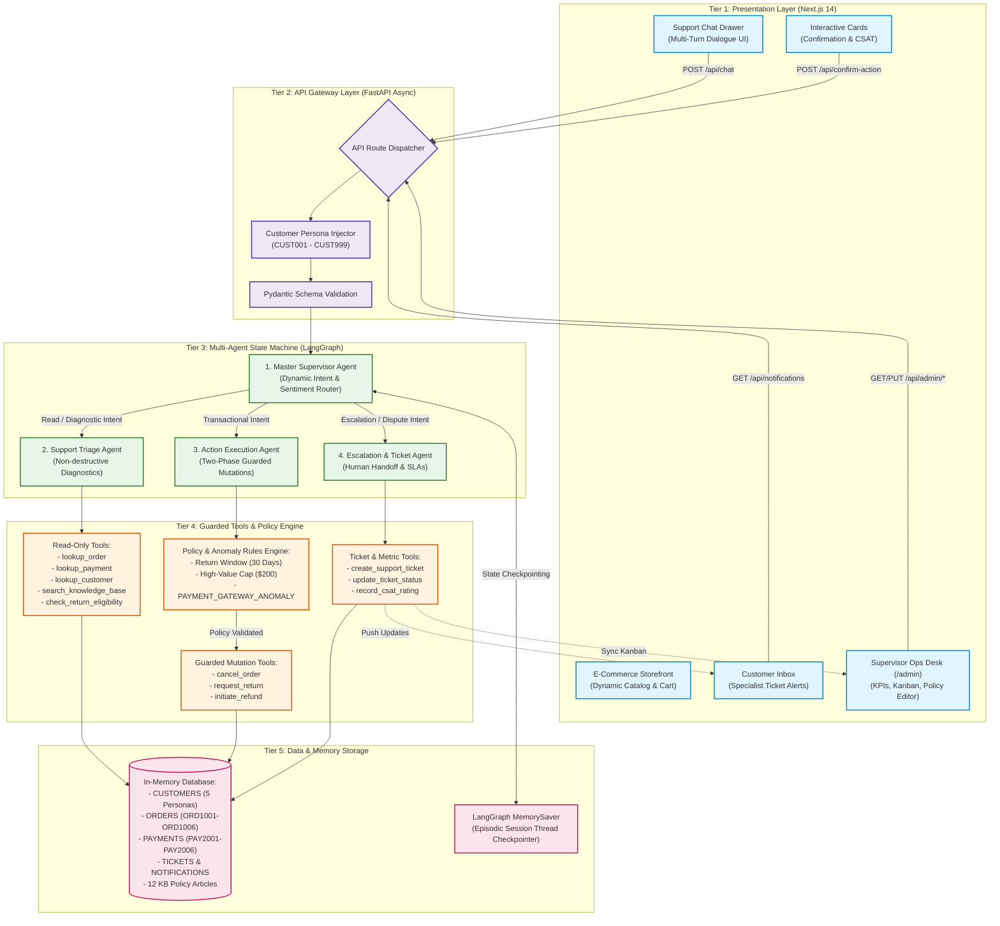
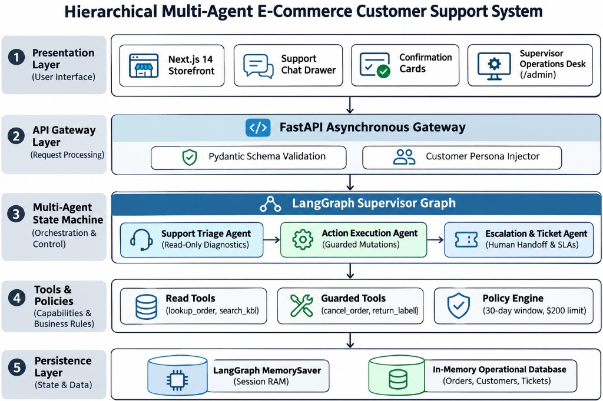
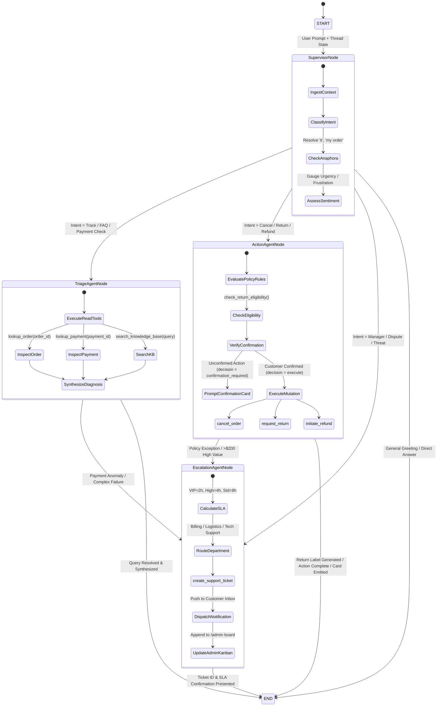
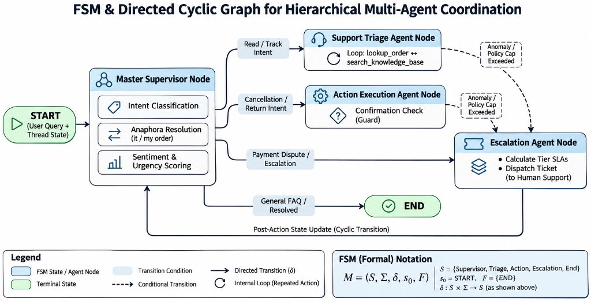
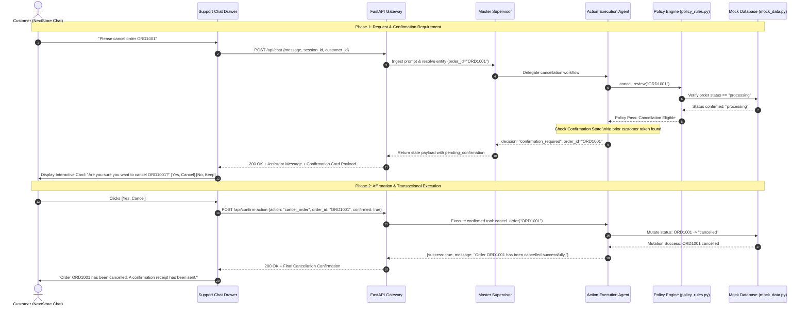
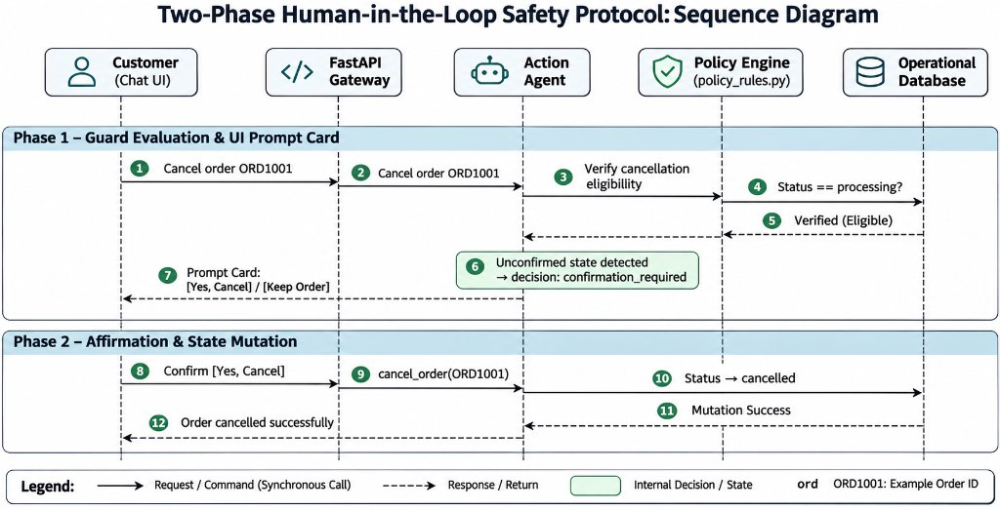
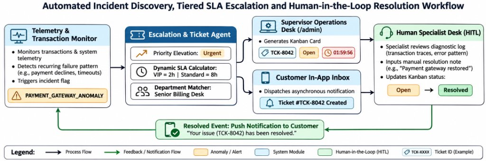
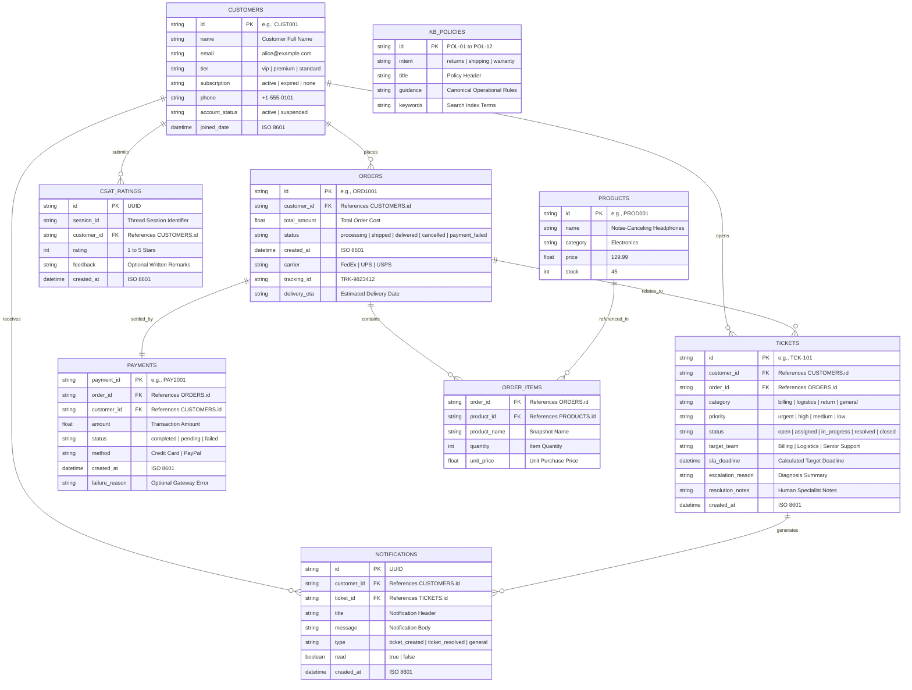
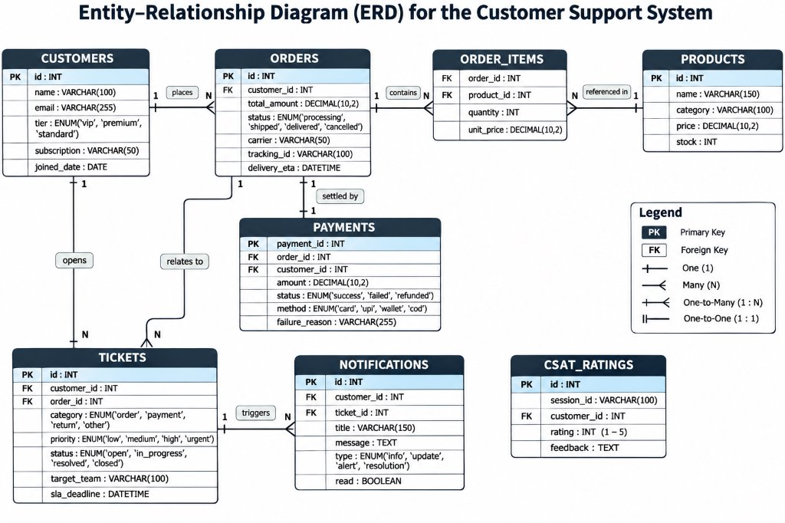

# NextSupport AI — Conceptual System Design and Architecture Specification

## 1. Executive Summary & Design Principles

The **NextSupport AI (PS-04)** platform is an enterprise-grade, autonomous conversational customer support architecture engineered to resolve post-purchase e-commerce inquiries. It replaces monolithic, unconstrained chatbots with a **hierarchical multi-agent state graph** governed by strict privilege separation, stateful thread checkpointing, two-phase confirmation guards, and human-in-the-loop (HITL) escalation mechanisms.

```text
+----------------------------------------------------------------------------------------------------+
|                                      Core Design Principles                                        |
+----------------------------------------------------------------------------------------------------+
| 1. Least Privilege Tool Isolation: Read-only investigative tools are strictly segregated from      |
|    destructive transactional mutation tools.                                                       |
| 2. Two-Phase Interactive Confirmation: Destructive mutations (cancellations/refunds) cannot        |
|    execute in a single turn without explicit customer UI card affirmation.                         |
| 3. Episodic Memory Checkpointing: Graph states are serialized at node boundaries, enabling         |
|    zero-loss multi-turn anaphora resolution and human-in-the-loop workflow resumption.              |
| 4. Deterministic Offline Resiliency: Complete functional dual-mode support—cloud agentic via       |
|    Google Gemini and 100% offline rule-based supervisor execution when API keys are absent.        |
+----------------------------------------------------------------------------------------------------+
```

---

## 2. Five-Tier System Architecture

The system is decoupled across five cohesive architectural tiers, ensuring linear scalability, high maintainability, and enterprise security:

```text
+----------------------------------------------------------------------------------------------------+
| Tier 1: Presentation Tier (Next.js 14, React, Tailwind CSS)                                       |
| Storefront Catalog | Support Chat Drawer | Confirmation Cards | Ops Desk (/admin) | Customer Inbox |
+----------------------------------------------------------------------------------------------------+
                                                  | HTTP / JSON REST (Port 3000 -> 8000)
                                                  v
+----------------------------------------------------------------------------------------------------+
| Tier 2: API Gateway & Session Orchestration (FastAPI Async)                                        |
| Pydantic Schema Validation | Persona Context Injection | Route Handlers | CORS & Rate Limiting     |
+----------------------------------------------------------------------------------------------------+
                                                  |
                                                  v
+----------------------------------------------------------------------------------------------------+
| Tier 3: Hierarchical Multi-Agent State Machine (LangGraph & Gemini)                                |
| Master Supervisor (Router) | Support Triage Agent | Action Agent | Escalation & Ticket Agent        |
+----------------------------------------------------------------------------------------------------+
                                                  | Tool Execution Protocols
                                                  v
+----------------------------------------------------------------------------------------------------+
| Tier 4: Guarded Tool Modules & Policy Engine                                                       |
| Investigation Tools (Read) | Action Tools (Write/Guarded) | Ticket Tools | Policy Rules & Anomaly  |
+----------------------------------------------------------------------------------------------------+
                                                  |
                                                  v
+----------------------------------------------------------------------------------------------------+
| Tier 5: Ephemeral Data & State Checkpoint Persistence                                              |
| LangGraph MemorySaver (Session RAM) | In-Memory Database (Customers, Orders, Payments, Tickets)   |
+----------------------------------------------------------------------------------------------------+
```

### Tier 1: Presentation Tier (Client)
- **Storefront & Dynamic Catalog**: Next.js 14 client rendering product listings, shopping cart, and live order tracking.
- **Support Chat Drawer**: Collapsible conversational interface with multi-turn message history, optimistic UI rendering, and customer sentiment awareness.
- **Interactive Action Cards**: Specialized UI widgets prompting two-phase confirmation (`Yes, Cancel Order` / `Keep Order`) and CSAT star rating widgets.
- **Supervisor Operations Desk (`/admin`)**: Administrative operations center featuring real-time KPI telemetry, an interactive Kanban ticket board, an anomaly alert feed, and a live policy editor.
- **Customer Notification Center**: In-app inbox receiving asynchronous updates when human specialists resolve escalated tickets.

### Tier 2: API Gateway & Routing Tier
- Built on **FastAPI (v0.100+)** delivering high-throughput asynchronous request handling.
- Validates inbound payloads using strict **Pydantic v2 schemas**.
- Dynamically extracts customer session headers (`X-Customer-Id`) via the **Persona Switcher** to ground dialogues in active customer records.
- Dispatches requests across dedicated route controllers (`ecommerce_routes.py`, `action_routes.py`, `ticket_routes.py`, `admin_routes.py`, `notification_routes.py`).

### Tier 3: Hierarchical Multi-Agent State Machine Tier
- Governed by **LangGraph cyclic state graphs** backed by Google Gemini 3.5 Flash-Lite function calling.
- **Master Supervisor Agent**: Evaluates conversational intent, detects urgency/sentiment, inspects thread history, and dynamically delegates to specialized domain subgraphs.
- **Support Triage Agent**: ReAct subagent dedicated to non-destructive order diagnostics, payment inspections, and policy lookups.
- **Action Execution Agent**: ReAct subagent executing transactional updates locked behind confirmation guards.
- **Escalation & Ticket Agent**: ReAct subagent managing human handoffs, SLA deadline calculations, and incident tracking.

### Tier 4: Tool Execution & Policy Engine Tier
- **Read-Only Investigative Tools**: `lookup_order`, `lookup_payment`, `lookup_customer`, `search_knowledge_base`, `check_return_eligibility`.
- **Guarded Action Mutation Tools**: `cancel_order`, `request_return`, `initiate_refund`.
- **Escalation & Telemetry Tools**: `create_support_ticket`, `update_ticket_status`, `search_tickets`, `record_csat_rating`, `get_resolution_metrics`.
- **Policy Engine (`policy_rules.py`)**: Programmatic business rule validator enforcing return windows (30 days), non-returnable categories, high-value transaction review ($200 cap), and gateway anomaly triggers.

### Tier 5: Ephemeral Data & State Persistence Tier
- **LangGraph `MemorySaver`**: In-memory episodic checkpointer storing serialized execution states keyed by `session_id` / `thread_id`.
- **In-Memory Operational Mock Database (`mock_data.py`)**: Strongly typed data structures maintaining customers, products, orders, payments, tickets, notifications, and CSAT scores with realistic relative timestamps.

---

## 3. System Architecture & Component Diagrams

### 3.1 End-to-End System Architecture

The following diagram illustrates the complete end-to-end component interaction flow across all architectural tiers:





> **Figure 1:** Conceptual End-to-End System Architecture illustrating presentation components, API routing, multi-agent state machines, guarded tool modules, and in-memory persistence.

---

### 3.2 LangGraph State Machine & Agent Routing Workflow

The state machine is modeled as a cyclic state graph compiling conditional edges based on conversational intent, execution status, and safety policy checks:





> **Figure 2:** LangGraph Multi-Agent State Machine Workflow showing conditional routing across Supervisor, Triage, Action, and Escalation nodes.

---

### 3.3 Two-Phase Interactive Confirmation Sequence Diagram

Destructive transactional mutations are safeguarded by a two-phase confirmation protocol. The diagram below traces the interaction lifecycle when a customer requests an order cancellation:





> **Figure 3:** Two-Phase Interactive Confirmation Sequence Diagram for destructive database operations.

---

### 3.4 Automated Escalation & Incident Management Workflow

When automated diagnosis encounters systemic failures or policy barriers, the system escalates cases seamlessly without losing context:

```mermaid
sequenceDiagram
    autonumber
    actor Customer as Customer (Charlie Davis - CUST003)
    participant ChatUI as Support Chat Drawer
    participant Gateway as FastAPI Gateway
    participant Triage as Support Triage Agent
    participant AnomalyEngine as Anomaly Monitor
    participant Escalation as Escalation & Ticket Agent
    participant OpsDesk as Supervisor Desk (/admin)
    participant Inbox as Customer Notification Inbox

    Customer->>ChatUI: "My payment for ORD1003 was debited but status says failed!"
    ChatUI->>Gateway: POST /api/chat {session_id, customer_id="CUST003"}
    Gateway->>Triage: Investigate payment record PAY2003
    Triage->>AnomalyEngine: Evaluate payment transaction stream
    Note over AnomalyEngine: Anomaly Check: 3+ failures in 1h window\nFlag: PAYMENT_GATEWAY_ANOMALY
    AnomalyEngine-->>Triage: Incident Alert Triggered
    Triage->>Escalation: Trigger automated handoff with incident diagnostics
    Note over Escalation: Calculate SLA:\nCustomer Tier: Standard\nPriority: High (Financial Debit)\nTarget SLA: 4 Hours
    Escalation->>OpsDesk: Create Support Ticket: TCK-8042 (Dept: Billing, Priority: High)
    Escalation->>Inbox: Dispatch Notification: "Support Ticket #TCK-8042 opened. SLA: 4 hours."
    Escalation-->>Gateway: Assistant response with Ticket ID and SLA guarantee
    Gateway-->>ChatUI: Deliver empathetic response + Ticket reference
    ChatUI->>Customer: "I have escalated this to our Senior Billing Team under Ticket #TCK-8042 (SLA: 4 hours)."

    Note over OpsDesk,Inbox: Human-in-the-Loop (HITL) Resolution
    actor Specialist as Human Billing Specialist
    Specialist->>OpsDesk: Inspects Kanban Board, selects TCK-8042
    Specialist->>OpsDesk: Enters resolution note: "Reconciled with payment gateway; order released."
    OpsDesk->>Gateway: PUT /api/admin/tickets/TCK-8042 {status: "resolved"}
    Gateway->>Inbox: Push resolved notification to customer inbox
    Customer->>Inbox: Views real-time resolution update in notification tray
```



> **Figure 4:** Sequence Diagram illustrating anomaly discovery, ticket generation with tier-based SLA, and HITL specialist resolution.

---

### 3.5 Entity-Relationship Diagram (ERD)

The data model for the in-memory enterprise database is structured as follows:





> **Figure 5:** Entity-Relationship Diagram detailing relational keys, foreign references, and attributes across mock data collections.

---

## 4. State Management & Schema Contracts

### 4.1 LangGraph State Schema (`SupportAgentState`)

The state shared across all nodes within the LangGraph state machine is strictly typed using `typing.TypedDict` and annotated message reducers:

```python
class SupportAgentState(TypedDict, total=False):
    # Core Message History (Annotated reducer appends new turns)
    messages: Annotated[List[BaseMessage], add_messages]
    
    # Session & Customer Context
    session_id: str
    user_message: str
    customer_id: Optional[str]
    order_id: Optional[str]
    
    # Agent Routing & Intent Classification
    active_agent: Optional[str]        # 'triage_agent' | 'action_agent' | 'escalation_agent'
    intent: Optional[str]              # 'order_status' | 'cancel' | 'return' | 'escalation'
    sentiment: Optional[str]           # 'positive' | 'neutral' | 'frustrated' | 'urgent'
    priority: Optional[str]            # 'urgent' | 'high' | 'medium' | 'low'
    
    # Tool Evidence & Intermediate Data
    investigation: Optional[Dict[str, Any]]
    knowledge_results: Optional[List[Dict[str, Any]]]
    action_result: Optional[Dict[str, Any]]
    
    # Safety Guards & Confirmation State
    pending_confirmation: Optional[Dict[str, Any]]  # Stores {action, order_id, params}
    decision: Optional[str]                         # 'confirmation_required' | 'execute' | 'escalate'
    
    # Ticket & Escalation Data
    ticket: Optional[Dict[str, Any]]
    escalation_reason: Optional[str]
    target_team: Optional[str]
    policy_ref: Optional[str]
    
    # Output Synthesis
    assistant_message: str
```

### 4.2 REST API Interface Contracts

| Endpoint | Method | Input Payload | Output Response | Function / Purpose |
| :--- | :---: | :--- | :--- | :--- |
| `/api/chat` | `POST` | `{message: str, session_id: str, customer_id: str}` | `{response: str, active_agent: str, pending_confirmation: dict, ticket: dict}` | Core conversation turn submission and multi-agent synthesis. |
| `/api/confirm-action` | `POST` | `{action: str, order_id: str, confirmed: bool, session_id: str}` | `{success: bool, message: str, updated_order: dict}` | Submits user confirmation for two-phase guarded operations. |
| `/api/customers/{id}` | `GET` | *Path parameter: `id`* | `{customer: dict, active_orders: list, past_tickets: list}` | Retrieves customer context and order history for persona switching. |
| `/api/notifications` | `GET` | `?customer_id=CUST001` | `{notifications: list, unread_count: int}` | Fetches in-app customer notification tray items. |
| `/api/admin/metrics` | `GET` | *None* | `{total_tickets: int, auto_resolution_rate: float, escalation_rate: float, csat_avg: float}` | Real-time KPI feed for the Supervisor Operations Desk. |
| `/api/admin/tickets` | `GET/PUT` | `PUT: {ticket_id: str, status: str, resolution_notes: str}` | `{updated_ticket: dict}` | Fetches Kanban board tickets and supports human specialist case closure. |
| `/api/admin/policies` | `GET/POST` | `POST: {policy_id: str, guidance: str}` | `{policies: list, status: "updated"}` | Runtime hot-reloading of enterprise business policies. |

---

## 5. Security Boundaries, Safety Guards, and Resilience

```text
+----------------------------------------------------------------------------------------------------+
|                                    System Defense-in-Depth                                         |
+----------------------------------------------------------------------------------------------------+
| [Level 1: Least Privilege] Read tools cannot alter state; write tools locked behind policy.        |
| [Level 2: Interactive Guard] Irreversible operations halt for user UI confirmation.                |
| [Level 3: Policy Limits] Strict caps ($200 high-value threshold, 30-day return window).            |
| [Level 4: Anomaly Detection] Automated monitoring flags systemic failures (PAYMENT_GATEWAY_ANOMALY)|
| [Level 5: Dual-Mode Resilience] Deterministic offline fallback engine guarantees zero downtime.    |
+----------------------------------------------------------------------------------------------------+
```

### 5.1 Privilege Separation & Two-Phase Confirmation Guard
- **Read/Write Tool Isolation**: Investigative tools (`lookup_order`, `lookup_payment`, `search_knowledge_base`) operate in strict read-only mode and do not possess database update handles. Action tools (`cancel_order`, `request_return`, `initiate_refund`) reside in a segregated module.
- **Two-Phase Interactive Card Guard**: The Action Execution Agent is programmatically prohibited from executing mutations on the initial request. When an action intent is detected, the graph transitions to `decision='confirmation_required'`, halts tool execution, and returns structured metadata prompting the frontend to render an interactive confirmation card. The database mutation is only triggered once the user submits explicit affirmation via `/api/confirm-action`.

### 5.2 Deterministic Offline Fallback Architecture
To ensure continuous operation without cloud dependency, rate limit failures, or credential expiration:
- When `GEMINI_API_KEY` is present, the backend utilizes `ChatGoogleGenerativeAI` with function calling.
- When `GEMINI_API_KEY` is omitted or cloud connectivity degrades, the system initializes `build_deterministic_support_graph()`.
- The deterministic supervisor utilizes regex entity extractors (`ORDER_ID_RE`, `CUSTOMER_ID_RE`, `AFFIRMATIVE_RE`, `NEGATIVE_RE`) and routing tables to execute identical tool sequences, state checkpointing, and ticket generation with **100% feature parity and zero downtime**.

### 5.3 Anomaly Incident Detection & Operational Telemetry
- An automated anomaly detection engine monitors transaction logs in `mock_data.py`.
- If three or more payment failures occur within a rolling time window, the system automatically registers a `PAYMENT_GATEWAY_ANOMALY`.
- When an anomaly is detected, customer support requests regarding payment status are automatically prioritized, high-urgency tags are assigned, and operations incident alerts are pushed directly to the `/admin` Operations Desk.

---

## 6. Architectural Summary

The **NextSupport AI (PS-04)** architectural design establishes a robust, enterprise-grade paradigm for autonomous conversational customer support. By replacing monolithic, unconstrained conversational chatbots with a **hierarchical multi-agent state graph**, the system achieves an optimal balance between conversational fluidity, rigorous business policy enforcement, and transactional database safety.

```text
+----------------------------------------------------------------------------------------------------+
|                                  Architectural Summary Matrix                                      |
+----------------------------------------------------------------------------------------------------+
| Architectural Dimension   | Technical Implementation              | Operational Benefit            |
|---------------------------+---------------------------------------+--------------------------------|
| Orchestration & Routing   | LangGraph Master Supervisor Graph     | Eliminates unstructured chatter|
|                           |                                       | & guarantees clear delegation  |
| Transactional Safety      | Two-Phase Interactive Confirmation    | Prevents accidental or         |
|                           | Cards & Strict Privilege Boundaries   | hallucinated database writes   |
| Multi-Turn Memory         | LangGraph MemorySaver Checkpointing   | Resolves anaphoric pronouns    |
|                           |                                       | ("it", "my order") across turns|
| Policy Grounding          | 12-Policy Grounded Engine with Live   | Eliminates policy hallucination|
|                           | Runtime Admin Hot-Reloading           | with zero-downtime updates     |
| Human Handoff & Tracking  | 5-Stage Kanban Ticket Lifecycle &     | Enforces tier-based SLAs and   |
|                           | Direct Customer Inbox Notifications   | closes the escalation loop     |
| Incident Telemetry        | Automated Anomaly Discovery           | Flags systemic incidents       |
|                           | (PAYMENT_GATEWAY_ANOMALY)             | directly to operations staff   |
| Fault Tolerance           | Deterministic Regex & Pattern Engine  | 100% offline uptime & zero     |
|                           |                                       | dependency on cloud API keys   |
+----------------------------------------------------------------------------------------------------+
```

### Key Architectural Takeaways

1. **Guarded Multi-Agent Decomposition**: The system successfully segregates responsibilities across specialized functional nodes: non-destructive diagnostics (Triage), policy-constrained transactional execution (Action), and SLA-driven human handoffs (Escalation). This modular design prevents prompt distraction and enforces least-privilege tool execution.
2. **Deterministic Safety over Stochastic Execution**: While Large Language Models provide natural language understanding, transactional database state changes are strictly gated by programmatic policy engines (`policy_rules.py`) and explicit, two-phase human confirmation prompts.
3. **Continuous State & Anaphora Persistence**: Utilizing episodic graph checkpointing ensures that conversation state is serialized at every step, allowing users to refer naturally to past items, orders, or topics without context loss.
4. **End-to-End Operational Integration**: Beyond customer-facing chat, the architecture integrates full operational lifecycle management—featuring real-time supervisor KPI telemetry, Kanban-based specialist resolution, and automated incident alerting.
5. **Production Resiliency**: The dual-mode engine ensures that NextSupport AI operates reliably under all conditions: providing rich generative dialogue when cloud LLM APIs are accessible, and seamlessly falling back to a deterministic state machine for offline reliability, automated unit testing, and business continuity.

